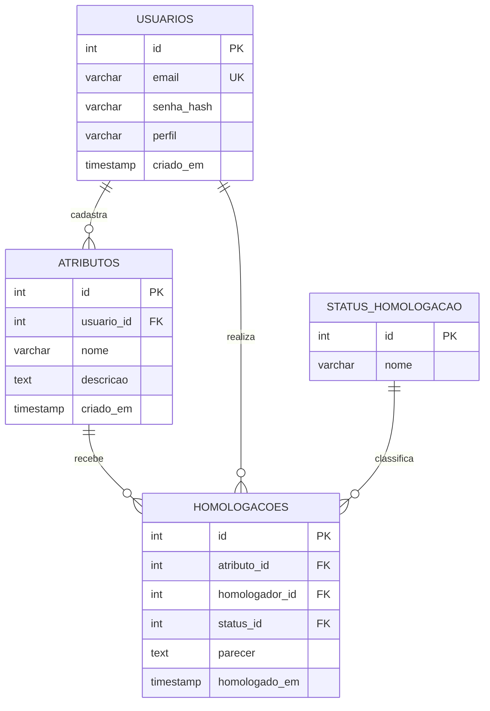

# Homologador de Atributos

Aplicação web destinada ao gerenciamento e à homologação de atributos, permitindo que usuários cadastrados consultem, submetam e acompanhem atributos em processo de homologação, além de possibilitar que usuários homologadores aprovem ou rejeitem solicitações mantendo o histórico completo de avaliações.

---

## Requisitos Atendidos

### Requisitos Funcionais (RF)
- **RF01 – Cadastro de usuário**: Criação de conta na aplicação (`POST /api/auth/cadastro`).
- **RF02 – Login**: Autenticação de usuários cadastrados com emissão de token JWT (`POST /api/auth/login`).
- **RF03 – Cadastro de atributos**: Submissão de novos atributos para homologação (`POST /api/atributos`).
- **RF04 – Consulta de atributos**: Listagem, busca e filtragem por status de todos os atributos cadastrados (`GET /api/atributos` e `GET /api/atributos/{id}`).
- **RF05 – Homologação de atributos**: Aprovação ou rejeição de atributos com registro de parecer por usuários autorizados com perfil `homologador` (`POST /api/atributos/{id}/homologar` e `POST /api/homologacoes`).
- **RF06 – Acompanhamento**: Painel dedicado para acompanhamento do andamento, linha do tempo de pareceres e ressubmissão de atributos rejeitados (`GET /api/atributos/meus` e `POST /api/atributos/{id}/ressubmeter`).

### Requisitos Não Funcionais (RNF)
- **RNF01 – Privacidade**: Informações pessoais (como e-mail) de um usuário não são expostas a outros usuários nas consultas de atributos e históricos.
- **RNF02 – Segurança**: Senhas armazenadas exclusivamente com hash criptográfico `bcrypt` com *salt* aleatório.
- **RNF03 – Portabilidade**: Ambiente empacotado e orquestrado com **Docker** e **Docker Compose**.
- **RNF04 – Persistência**: Banco de dados relacional **PostgreSQL 16** com volume persistente.
- **RNF05 – Usabilidade**: Interface web moderna, responsiva, simples e intuitiva em português.

---

## Diagrama Entidade-Relacionamento (ER)



---

## Tecnologias Utilizadas

- **Backend**: Python 3.12, FastAPI, SQLAlchemy 2.0, Pydantic v2, PyJWT, `bcrypt`
- **Banco de Dados**: PostgreSQL 16 (`psycopg` v3)
- **Frontend**: HTML5, CSS3 responsivo e JavaScript ES6 modular
- **Infraestrutura**: Docker e Docker Compose

---

## Como Executar com Docker (Recomendado)

1. Suba os containers da aplicação e do banco PostgreSQL:

```bash
docker compose up --build -d
```

2. Acesse no navegador:
   - **Interface Web**: http://localhost:8000
   - **Documentação Interativa da API (Swagger)**: http://localhost:8000/docs

3. Para encerrar os containers:

```bash
docker compose down
```

### Conta Inicial de Homologador (Seed Automático)

Ao iniciar, o sistema cadastra automaticamente os status padrão (`pendente`, `aprovado`, `rejeitado`) e uma conta autorizada para homologação (configurável via variáveis `ADMIN_EMAIL` e `ADMIN_PASSWORD`):

- **E-mail**: `homologador@sistema.com`
- **Senha**: `Homologador@123`
- **Perfil**: `homologador`

---

## Estrutura do Projeto

```text
homologador/
├── app/
│   ├── config.py           # Configurações e variáveis de ambiente
│   ├── database.py         # Conexão SQLAlchemy com PostgreSQL
│   ├── main.py             # Aplicação FastAPI e entrega do frontend
│   ├── models.py           # Entidades ORM (usuarios, atributos, homologacoes, status_homologacao)
│   ├── schemas.py          # Contratos de entrada/saída Pydantic
│   ├── security.py         # Hash bcrypt e autenticação JWT
│   ├── seed.py             # Carga inicial de status e usuário homologador
│   └── routers/
│       ├── auth.py         # Cadastro, login e sessão atual
│       ├── atributos.py    # Cadastro, consulta, acompanhamento e ressubmissão
│       └── homologacoes.py # Avaliação e listagem de status
├── db/
│   └── init.sql            # Script DDL de referência para o PostgreSQL
├── frontend/
│   ├── index.html          # Interface de usuário (SPA)
│   ├── css/styles.css      # Estilos responsivos
│   └── js/                 # Cliente HTTP e lógica de estado/componentes
├── tests/
│   └── test_app.py         # Testes automatizados com Pytest
├── Dockerfile
├── docker-compose.yml
└── requirements.txt
```
